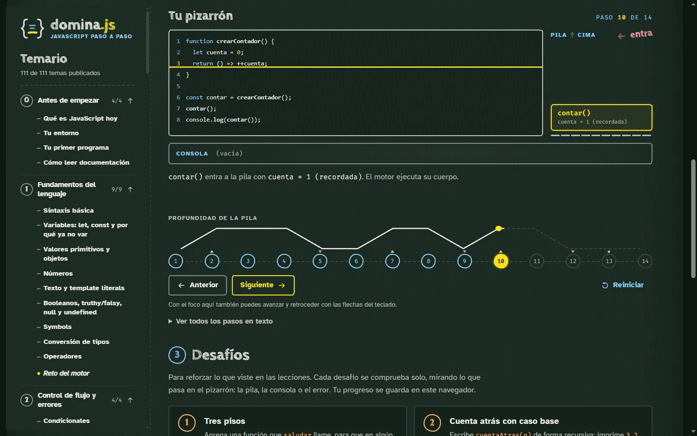
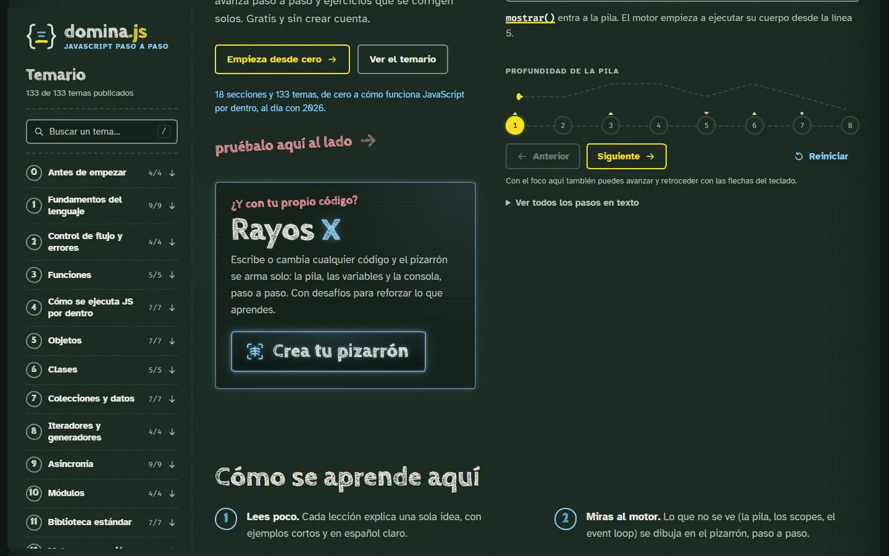
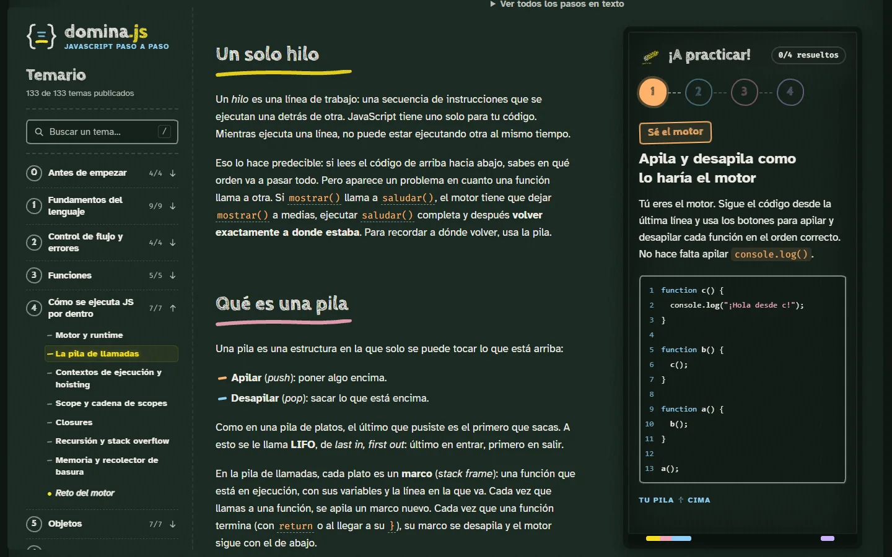
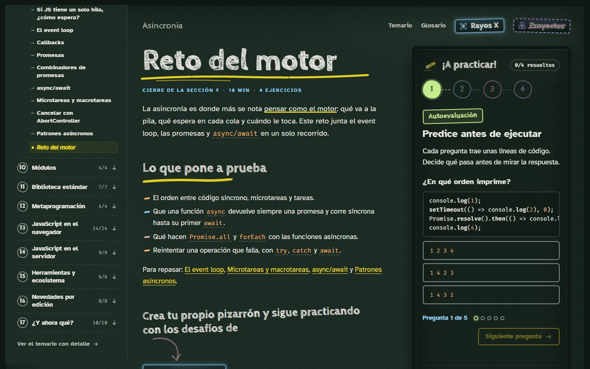
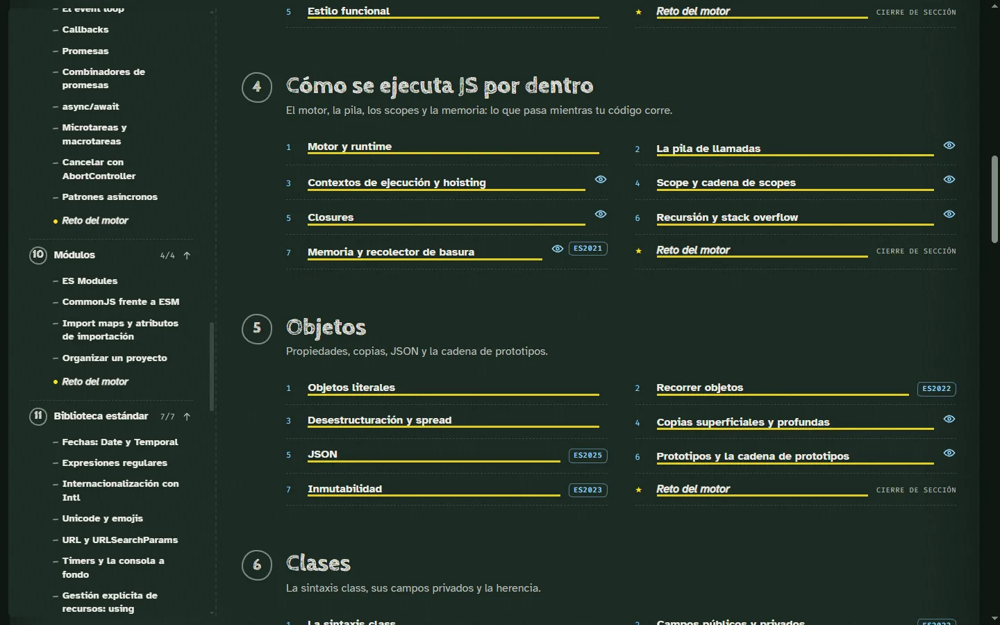
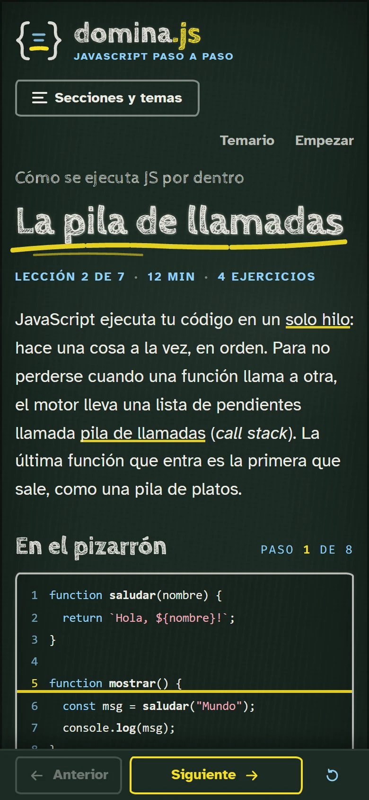

# domina-js

**Aprende JavaScript viendo lo que hace el motor.** Un curso gratis, en español y sin cuentas: lecciones cortas, un pizarrón que avanza paso a paso y ejercicios que se corrigen solos. Va de cero a cómo funciona JavaScript por dentro, al día con 2026.

**👉 [domina-js.pages.dev](https://domina-js.pages.dev)**


| | |
|---|---|
| **18 secciones** | de «Antes de empezar» a «¿Y ahora qué?», el mapa de lo que se aprende después |
| **133 lecciones** | todas publicadas |
| **520 ejercicios** | 456 en las lecciones y 64 en los Retos del motor, con corrección automática y progreso guardado en el navegador |
| **34 pizarrones** | visualizadores paso a paso de la pila, los scopes, la memoria y el event loop |
| **Rayos X** | tu propio pizarrón: 12 pizarrones para modificar y 12 desafíos de refuerzo, también con asincronía |
| **135 términos** | en un glosario enlazado a las lecciones |

## Qué lo hace distinto

### Un pizarrón que muestra lo invisible

Cada tema difícil trae un visualizador. A la izquierda, el código, con la línea que se ejecuta subrayada en amarillo. A la derecha, lo que el motor tiene en ese momento: pila de llamadas, variables, consola y colas del event loop. Avanzas con «Siguiente» o con las flechas del teclado, y en algunos pasos el pizarrón te pide que **predigas** qué viene antes de mostrártelo.


### Rayos X: tu propio pizarrón

En [`/rayos-x`](https://domina-js.pages.dev/rayos-x) eliges uno de los pizarrones listos: la pila, recursión, closures, `var` y `let` en un bucle, la zona muerta temporal, scope, funciones como valores, un error atrapado, `setTimeout` de 0 ms, microtareas, una promesa con su `then` o `async`/`await`. Le cambias lo que quieras en el editor y pulsas **Ejecutar**. El sitio corre tu código con un intérprete propio, escrito sobre [Acorn](https://github.com/acornjs/acorn), y arma el pizarrón solo, con todo esto:

- qué funciones están en la pila;
- qué valen sus variables, también las que **recuerda un closure**;
- qué sale por la consola;
- con código asíncrono, **el event loop**: los temporizadores que cuenta el runtime, la cola de tareas, la de microtareas y las funciones `async` en pausa por un `await`;
- una explicación en español de cada paso.




Debajo hay **desafíos de refuerzo**, distintos a los de las lecciones, por ejemplo:

- «haz que la pila llegue a 3 funciones»;
- «desborda la pila a propósito»;
- «cambia una sola palabra para que imprima `0 1 2`»;
- «escribe un contador que recuerde su cuenta»;
- «cuela una microtarea antes del temporizador»;
- «escribe `esperar(ms)` con una promesa y `setTimeout`».

Cada uno se comprueba mirando lo que pasa en el pizarrón (la pila, las colas, la consola o el error), no con tests ocultos.


El intérprete corre en un Web Worker y no usa `eval`. Entiende `setTimeout`, `clearTimeout`, `queueMicrotask`, promesas (`then`, `catch`, `finally`, `Promise.all`, `race` y `allSettled`) y `async`/`await`. Sus sentencias son generadores, así que un `await` puede pausar una función a la mitad, y el event loop la retoma después. El orden de la consola se comprobó contra Node, y el tiempo es simulado: un temporizador de 1000 ms no hace esperar un segundo. Si el código usa algo que todavía no entiende (clases, generadores, `setInterval`, desestructuración…), dice qué es y en qué línea. Corta los bucles infinitos a los 400 pasos y desborda la pila a las 12 llamadas, para que el desborde se pueda ver. A Rayos X se llega desde un botón propio en la navegación, desde la portada y desde el final de cada Reto del motor.



### Ejercicios que no son solo «escribe y ejecuta»

Al costado de cada lección hay un pizarrón de práctica con varios formatos:

- **Sé el motor:** haces tú el trabajo del motor, apilando y desapilando llamadas en el orden correcto.
- **Ordena la salida:** ordenas las líneas que imprimiría la consola.
- **Detective:** recibes un error real con su *stack trace*, encuentras la línea culpable y eliges el arreglo.
- **Laboratorio:** escribes código en un editor y una lista de pruebas visibles se pone en verde mientras escribes.
- **Autoevaluación:** preguntas cortas para comprobar que entendiste.

Las pistas se piden de a una y la solución se explica. El código nunca aparece en blanco plano: en las preguntas, las opciones y las pistas lleva los mismos colores que el editor. El progreso se guarda solo en tu navegador.



### Un Reto del motor al cerrar cada sección

Las secciones 1 a 16 terminan con un **Reto del motor**. No es un examen: son cuatro ejercicios que mezclan los temas de toda la sección, como pasa en un programa de verdad. Hay preguntas de predecir, una salida para ordenar, un Detective con un error real de Node o del navegador y un laboratorio. El reto aparece al final de cada sección en el menú y en el temario, y «Continúa con» pasa por él antes de saltar a la siguiente sección.




### Ejemplos que se ejecutan

Los bloques de código de las lecciones tienen un botón **Ejecutar**. El código corre aislado, en un Web Worker o en un iframe con *sandbox*, con un tiempo máximo y la consola capturada. Los ejemplos que necesitan lo que ese iframe no tiene (red en vivo, permisos, cámara, sonido, una base de datos de Node) quedan solo para copiar.

Dos detalles del iframe: como es de otro origen, el navegador no le deja tomar el foco por su cuenta, así que en los ejemplos y laboratorios que usan `focus()` la página se lo presta mientras el código corre y después lo devuelve. Y como fuera de la pantalla no se dibuja (y sin cuadros no llegan eventos como el `close` de un `<dialog>`), la vista del ejemplo se acerca a la pantalla al ejecutar, y la copia oculta donde corren las verificaciones queda invisible pero dentro de ella.

### Al día con el lenguaje

El temario cubre lo que JavaScript sumó hasta hoy. Cada novedad lleva la insignia de su edición (ES2021 a ES2026), y las ediciones se verificaron contra la tabla de propuestas terminadas de TC39. También hay páginas para ES2027, ya cerrada, y para lo que viene en camino.

### Un glosario enlazado

En [`/glosario`](https://domina-js.pages.dev/glosario) están los términos del curso (closure, hoisting, microtarea, zona muerta temporal…) explicados en una o dos frases. Cada uno trae su nombre en inglés, otras formas de decirlo y un enlace al apartado exacto de la lección donde se ve a fondo. Se puede filtrar escribiendo, también en inglés. Al construir el sitio se comprueba que cada enlace lleve a una lección y a un apartado que existen.


### La barra lateral

El temario completo vive en la barra lateral. Al entrar, todas las secciones están cerradas: cada persona abre las que le interesan, y las que abrió siguen abiertas mientras navega por el sitio (se recuerdan en `sessionStorage`, solo durante la visita).

### Un buscador en la barra lateral

Arriba del temario, en todas las páginas, hay un buscador que recorre las lecciones, los Retos del motor, el glosario y Rayos X. Cada resultado dice de qué sección es, muestra un pedazo del texto con las palabras encontradas resaltadas y, cuando conviene, enlaza al apartado exacto de la lección. Se abre con la tecla <kbd>/</kbd>; las flechas recorren los resultados y <kbd>Esc</kbd> lo limpia. Usa [Pagefind](https://pagefind.app), que arma el índice al compilar, así que funciona sin servidor. En el teléfono está dentro del menú «Secciones y temas».

## El temario

0. Antes de empezar
1. Fundamentos del lenguaje
2. Control de flujo y errores
3. Funciones
4. Cómo se ejecuta JS por dentro
5. Objetos
6. Clases
7. Colecciones y datos
8. Iteradores y generadores
9. Asincronía
10. Módulos
11. Biblioteca estándar
12. Metaprogramación
13. JavaScript en el navegador
14. JavaScript en el servidor
15. Herramientas y ecosistema
16. Novedades por edición
17. ¿Y ahora qué?



## También en el teléfono

En pantallas chicas el temario se abre con un botón y los controles del pizarrón quedan fijos al pie mientras lo tienes a la vista.



## Tu progreso, en un archivo

El progreso vive solo en tu navegador, sin cuentas ni servidor. Al final del [temario](https://domina-js.pages.dev/temario), «Tu progreso» dice cuántos ejercicios y desafíos de Rayos X llevas resueltos, y tiene dos botones:

- **Descargar copia** guarda un archivo `domina-js-progreso-AAAA-MM-DD.json`.
- **Cargar copia** lo lee en cualquier navegador o equipo y lo **suma** a lo que ya tenías. Si un ejercicio está resuelto en cualquiera de los dos lados, queda resuelto: cargar una copia nunca borra progreso. Si el archivo no es una copia de domina-js, lo dice y no toca nada.

## Accesibilidad

- Todo se usa con el teclado: el pizarrón avanza con las flechas, los bloques de código que se desplazan reciben el foco y el foco siempre se ve, con una raya amarilla discontinua.
- Las explicaciones del pizarrón y los avisos de los ejercicios se anuncian a los lectores de pantalla (`aria-live`).
- Con «reducir movimiento» activado, las animaciones de tiza son instantáneas.
- Las 154 páginas pasan [axe](https://github.com/dequelabs/axe-core) (WCAG 2.2 AA y buenas prácticas) sin fallas, en escritorio y en móvil, con el progreso vacío y con todo resuelto. La última revisión fue el 22 de noviembre de 2026.

## Al compartir y en los buscadores

- Cada página tiene su URL canónica y su vista previa para redes y chats (Open Graph y Twitter), con la imagen `public/og.jpg` de 1200×630.
- `/sitemap.xml` se genera con las colecciones, así que cada lección o reto nuevo aparece solo. `public/robots.txt` apunta a él.
- Las direcciones que no existen muestran una página 404 propia («Esta página se borró del pizarrón»), con la ruta buscada dentro de un error de consola y enlaces al inicio, al temario y a Rayos X. Esa página no se indexa.

## Diseño

La dirección visual es **«Pizarrón y tiza amarilla»**: un tablero verde oscuro, solo con fondo oscuro, y una paleta que sale del amarillo del logo de JavaScript (`#F7DF1E`). Los títulos van en Tiza Domina (ver abajo), el texto en Atkinson Hyperlegible y el código en Fira Code, sin ligaduras. Rayos X tiene su propia estética de radiografía, en azul. El sistema completo está en [`DESIGN.md`](DESIGN.md), y las direcciones que no se eligieron quedan archivadas en [`docs/disenos/`](docs/disenos/).

## Hecho con

- [Astro](https://astro.build) 7 con MDX y *content collections*
- [CodeMirror](https://codemirror.net) 6 para el editor de los laboratorios y de Rayos X
- [Acorn](https://github.com/acornjs/acorn) para analizar el código que ejecuta Rayos X
- [Shiki](https://shiki.style), con un tema propio de tiza, para resaltar el código
- [Pagefind](https://pagefind.app) para el buscador
- Sin frameworks de interfaz: componentes de Astro y TypeScript

### Fuentes

- **Tiza Domina**, la letra de los títulos, es una versión modificada de [Cabin Sketch](https://fonts.google.com/specimen/Cabin+Sketch) (© 2011 The Cabin Project Authors). Está recortada a los caracteres que usa el sitio y tiene los contornos simplificados, para que pese la mitad y el navegador la dibuje más rápido. Como Cabin Sketch es un nombre reservado de su licencia, la versión modificada lleva otro nombre. Se distribuye bajo la [SIL Open Font License 1.1](src/fuentes/OFL.txt) y se regenera con `python herramientas/tiza-domina.py`.
- [Atkinson Hyperlegible](https://www.brailleinstitute.org/freefont/) y [Fira Code](https://github.com/tonsky/FiraCode), sin cambios, desde Fontsource (OFL 1.1).

## Cómo correrlo

Necesitas Node.js 22 o superior.

```sh
npm install
npm run dev       # servidor de desarrollo en http://localhost:4321
npm run build     # sitio estático en ./dist, con el índice del buscador (Pagefind)
npm run preview   # sirve ./dist para revisarlo antes de publicar
```

Con `npm run dev` el buscador usa el índice de la última compilación (`dist/pagefind`), así que corre `npm run build` una vez antes y de nuevo cuando quieras que encuentre texto nuevo. Si nunca compilaste, el buscador avisa que no tiene índice.

El sitio se publica en Cloudflare Pages con cada `git push` a `main`. `public/_headers` deja en caché por un año los archivos de `/_astro/`, que llevan un hash en el nombre. Las páginas se generan como archivos (`build.format: 'file'`) para que se sirvan sin redirección.

## Estructura

```text
src/
├── content/
│   ├── lecciones/      una lección por archivo .mdx (frontmatter: sección, tema, minutos, ejercicios…)
│   └── retos/          el Reto del motor de cada sección, uno por archivo .mdx
├── content.config.ts   el esquema de las lecciones y los retos
├── data/
│   ├── temario.ts      el temario completo: secciones, temas, insignias de edición y el recorrido con los retos
│   ├── glosario.ts     los términos del glosario y las lecciones donde se explican
│   ├── rayos-x.ts      los pizarrones listos y los desafíos de Rayos X
│   ├── ejercicios/     los ejercicios de cada sección, como datos (los de los retos, en ejercicios/retos/)
│   └── visualizaciones.ts   los pasos de cada pizarrón escrito a mano
├── lib/
│   ├── rayos-x.ts      el intérprete de Rayos X: recorre el código y genera los pasos del pizarrón
│   ├── rayos-x-reglas.ts    comprueba los objetivos de los desafíos
│   └── resaltar.ts     colorea el código de los ejercicios
├── components/         StepVisualizer, menú del temario, buscador, botón de Rayos X y los formatos de ejercicio
├── layouts/            BaseLayout (barra lateral) y LessonLayout (lecciones y retos)
├── pages/              portada, temario, glosario, Rayos X, 404, sitemap.xml y la ruta de cada lección y cada reto
├── scripts/            visualizador, editor de tiza, Rayos X, corrección de ejercicios, sandbox y progreso
├── fuentes/            Tiza Domina y su licencia
└── styles/global.css   tokens del pizarrón y estilos compartidos
public/                 favicon, og.jpg (vista previa al compartir), robots.txt y _headers
docs/
├── PLAN.md             el plan del proyecto: temario, arquitectura y fases
├── capturas/           las imágenes de este README
└── disenos/            direcciones de diseño archivadas
herramientas/
├── verificar-ejercicios.mjs   ejecuta los ejercicios en Node y comprueba salidas, soluciones y errores
└── tiza-domina.py             genera la fuente de los títulos
```

Para agregar una lección:

1. Crea el `.mdx` en `src/content/lecciones/`.
2. Regístrala en `src/data/temario.ts`.
3. Si lleva ejercicios, agrégalos como datos en `src/data/ejercicios/`.
4. Ejecuta `node herramientas/verificar-ejercicios.mjs`. Comprueba que cada «Ordena la salida» imprima lo que dice, que cada laboratorio se resuelva con su solución y que cada Detective lance el error que muestra.

## Lo que viene

- **Proyectos:** 30 aplicaciones completas hechas solo con JavaScript, para hacer paso a paso, de la más fácil a una final grande. Cada una con su `proyecto-inicial.zip` (HTML y CSS hechos, el JavaScript por escribir), su `proyecto-final.zip` y una demo para probarla en el navegador. El código vive en su propio repositorio, [domina-js-proyectos](https://github.com/renzoov/domina-js-proyectos), que aquí es el submódulo `proyectos/`, y las demos se publican en [domina-js-proyectos.pages.dev](https://domina-js-proyectos.pages.dev/01-generador-de-paletas/final/). Ya está el primero, el [Generador de paletas](https://domina-js.pages.dev/proyectos/generador-de-paletas). El plan está en [`docs/PROYECTOS.md`](docs/PROYECTOS.md).
- **Librerías:** 10 proyectos con las librerías más usadas para hacer aplicaciones (Zod, Prisma, Drizzle, Socket.IO, Chart.js, Leaflet, sharp y otras), sin frameworks de interfaz. Los que llevan servidor se hacen dos veces, con `node:http` y con Express, para comparar. El plan está en [`docs/LIBRERIAS.md`](docs/LIBRERIAS.md).

El detalle está en [`docs/PLAN.md`](docs/PLAN.md).

## ¿Encontraste un error?

Avísame con un [Issue](https://github.com/renzoov/domina-js/issues/new/choose). Hay tres formularios en español: «Error en una lección o ejercicio», «Algo no funciona en el sitio» y «Sugerencia». Desde el sitio también se llega de dos formas:

- con **«Reportar un problema»**, en el pie de todas las páginas;
- con **«¿Viste un error en esta lección?»**, al final de cada lección y de cada reto. Este enlace abre el formulario con la página y el título ya completados.

Los formularios están en [`.github/ISSUE_TEMPLATE/`](.github/ISSUE_TEMPLATE/).

## Licencia

- **El código** (componentes, scripts, estilos y herramientas) usa la licencia [MIT](LICENSE).
- **El contenido educativo** (lecciones, retos, ejercicios, pizarrones, glosario, desafíos y documentación) usa la licencia [CC BY 4.0](LICENSE-CONTENIDO.md). Puedes copiarlo, adaptarlo y usarlo en tus clases si das crédito a domina-js.
- **Las fuentes** usan la [SIL Open Font License 1.1](src/fuentes/OFL.txt).
