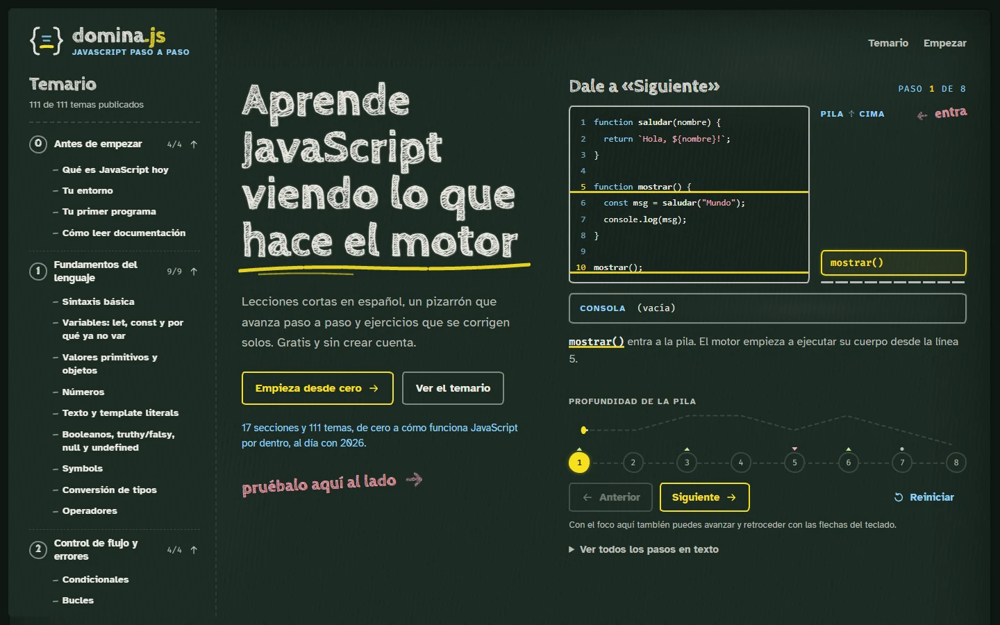
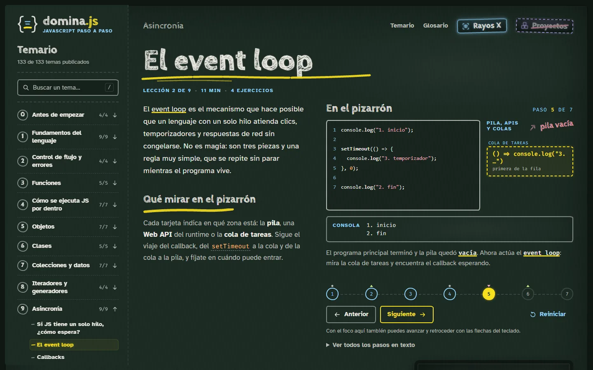

# domina-js

**Aprende JavaScript viendo lo que hace el motor.** Un curso gratis, en español y sin cuentas: lecciones cortas, un pizarrón que avanza paso a paso y ejercicios que se corrigen solos. Va de cero a cómo funciona JavaScript por dentro, al día con 2026.



| | |
|---|---|
| **17 secciones** | de «Antes de empezar» a las novedades de cada edición de ECMAScript |
| **111 lecciones** | todas publicadas |
| **400 ejercicios** | con corrección automática y progreso guardado en el navegador |
| **34 pizarrones** | visualizadores paso a paso de la pila, los scopes, la memoria y el event loop |

## Qué lo hace distinto

### Un pizarrón que muestra lo invisible

Cada tema difícil trae un visualizador: el código a la izquierda, con la línea que se ejecuta subrayada en amarillo, y a la derecha lo que el motor tiene en ese momento (pila de llamadas, variables, consola, colas del event loop). Avanzas con «Siguiente» o con las flechas del teclado, y en algunos pasos el pizarrón te pide que **predigas** qué viene antes de mostrártelo.




### Ejercicios que no son solo «escribe y ejecuta»

Al costado de cada lección hay un pizarrón de práctica con varios formatos:

- **Sé el motor:** haces tú el trabajo del motor, apilando y desapilando llamadas en el orden correcto.
- **Ordena la salida:** ordenas las líneas que imprimiría la consola.
- **Detective:** recibes un error real con su *stack trace*, encuentras la línea culpable y eliges el arreglo.
- **Laboratorio:** escribes código en un editor y una lista de pruebas visibles se pone en verde mientras escribes.
- **Autoevaluación:** preguntas cortas para comprobar que entendiste.

Las pistas se piden de a una y la solución se explica. El progreso se guarda solo en tu navegador.


### Ejemplos que se ejecutan

Los bloques de código de las lecciones tienen un botón **Ejecutar**. El código corre aislado, en un Web Worker o en un iframe con *sandbox*, con un tiempo máximo y la consola capturada.

### Al día con el lenguaje

El temario cubre lo que JavaScript sumó hasta hoy. Cada novedad lleva la insignia de su edición (ES2021 a ES2026), y las ediciones se verificaron contra la tabla de propuestas terminadas de TC39. También hay páginas para ES2027, ya cerrada, y para lo que viene en camino.

## El temario

0. Antes de empezar
1. Fundamentos del lenguaje
2. Control de flujo y errores
3. Funciones
4. Cómo se ejecuta JS por dentro
5. Objetos
6. Clases
7. Colecciones y datos
8. Iteradores y generadores
9. Asincronía
10. Módulos
11. Biblioteca estándar
12. Metaprogramación
13. JavaScript en el navegador
14. JavaScript en el servidor
15. Herramientas y ecosistema
16. Novedades por edición


## También en el teléfono

En pantallas chicas el temario se abre con un botón y los controles del pizarrón quedan fijos al pie mientras lo tienes a la vista.


## Diseño

La dirección visual es **«Pizarrón y tiza amarilla»**: un tablero verde oscuro, solo con fondo oscuro, y una paleta que sale del amarillo del logo de JavaScript (`#F7DF1E`). Los títulos van en Cabin Sketch, el texto en Atkinson Hyperlegible y el código en Fira Code. El sistema completo está en [`DESIGN.md`](DESIGN.md) y las direcciones que no se eligieron quedan archivadas en [`docs/disenos/`](docs/disenos/).

## Hecho con

- [Astro](https://astro.build) 7 con MDX y *content collections*
- [CodeMirror](https://codemirror.net) 6 para el editor de los laboratorios
- [Shiki](https://shiki.style), con un tema propio de tiza, para resaltar el código
- Sin frameworks de interfaz: componentes de Astro y TypeScript

## Cómo correrlo

Necesitas Node.js 22 o superior.

```sh
npm install
npm run dev       # servidor de desarrollo en http://localhost:4321
npm run build     # sitio estático en ./dist
npm run preview   # sirve ./dist para revisarlo antes de publicar
```

## Estructura

```text
src/
├── content/
│   └── lecciones/      una lección por archivo .mdx (frontmatter: sección, tema, minutos, ejercicios…)
├── content.config.ts   el esquema de las lecciones
├── data/
│   ├── temario.ts      el temario completo: secciones, descripciones, temas e insignias de edición
│   ├── ejercicios/     los ejercicios de cada sección, como datos
│   └── visualizaciones.ts   los pasos de cada pizarrón
├── components/         StepVisualizer, menú del temario y los formatos de ejercicio
├── layouts/            BaseLayout (barra lateral) y LessonLayout
├── scripts/            visualizador, corrección de ejercicios, sandbox y progreso
└── styles/global.css   tokens del pizarrón y estilos compartidos
docs/
├── PLAN.md             el plan del proyecto: temario, arquitectura y fases
├── capturas/           las imágenes de este README
└── disenos/            direcciones de diseño archivadas
```

Para agregar una lección: crea el `.mdx` en `src/content/lecciones/`, regístrala en `src/data/temario.ts` y, si lleva ejercicios, agrégalos como datos en `src/data/ejercicios/`.

## Lo que viene

- **Modo Rayos X:** edita el código de un pizarrón, o escribe el tuyo, y el sitio genera los pasos solo, con un intérprete instrumentado que corre en un Web Worker.
- **Mira tu solución** y un formato nuevo, **Rómpelo**, apoyados en Rayos X.
- Un **Reto del motor** al final de cada sección y un **glosario**.
- Un **buscador** en la barra lateral.

El detalle está en [`docs/PLAN.md`](docs/PLAN.md).
